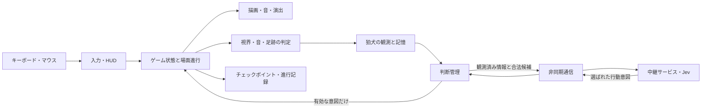
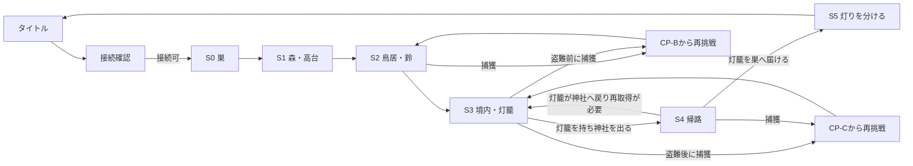

# 『こぎつねと冬の灯り』基本設計書

版: 0.4／2026-10-07  
状態: **レビュー用草案。全体構造とシステム間の契約を定める。未検証の方式と要確認の判断は確定仕様ではない。制作コードの着手は別途ユーザーの指示後。**

## 1. 目的と前提

本書は[要件定義書](requirements.md)、[ゲーム設計書](game-design.md)、[物語・レベル設計書](story-and-levels.md)、[美術・音・画面方針書](art-and-audio.md)を、画面・ゲーム状態・描画・Jev通信がつながる一つの構造へ落とす。操作のキー割当と全表示条件は`ui-and-controls.md`、狛犬の入力項目と合法候補は`komainu-jev.md`、素材形式とビルドは`technical-and-assets.md`で詳細化する。

| 区分 | 本書での扱い |
| --- | --- |
| ユーザー決定済み | Windows PC向け、キーボード・マウス、右下の常設行動ボタン、プレイ中のJev接続、短い切断時の代替行動、GitHubでソースとWindows実行版を公開、開始後5〜10分以内の最初のJev見せ場、一つの結末、守り手の石像・山犬の二形態、S2・S3の神社エリア共有と社前の灯籠台座、鳥居と倒木の二つの出入口、性格と観測からJevで意図を選び確率抽選しない方針（D-01〜04、D-07〜08、D-10、D-14〜17） |
| 本書の設計提案 | 6場面、画面遷移、状態の所有者、非同期判断、チェックポイントの復元方法、短い通信断から長い通信断への画面遷移 |
| 要検証・要確認 | 確定した神社エリアと台座の画面での見え方、カメラの詳細、描画方式、アプリ終了後の再開、長時間通信断の扱い、公開版の接続先とAPIキー管理、C-05の最終造形 |

**優先順位:** 本書が上位の要件やユーザー決定済み事項と食い違う場合は要件に戻す。調査資料は方式候補の根拠であり、採用済み仕様とは区別する。

## 2. 全体構成



| 部分 | 責務 | 所有しないもの |
| --- | --- | --- |
| 入力・HUD | キー・マウス操作を行動要求へ変換し、四行動と操作可否、危険の予兆、案内を表示する | 移動や盗難の成否、狛犬の知識 |
| ゲーム状態・場面進行 | 狐・灯籠・足跡・狛犬の真の位置、衝突、捕獲、チェックポイント、S0〜S5の遷移を確定する。唯一の正本とする | Jevに渡す推測や画面素材の具体形式 |
| 観測・記憶 | 視界・遮蔽・聴覚の判定結果から、狛犬が得た事実と時刻、調査の空振りを記録する | 見ていない狐の現在地や、まだ見ていない巣の事情 |
| 判断管理 | 状況から合法な意図を列挙し、Jevへの判断要求、応答の鮮度・合法性の確認、ローカル代替方針を扱う | 経路、移動速度、捕獲、結末の選択 |
| 描画・音・演出 | 正本の状態を絵・動き・音へ変換する。狛犬の選択に対応する予兆を動き出す前に見せる | 画面表示の都合で正本の観測・判定を書き換えること |
| 通信・中継 | ネットワーク処理とJevの認証情報をゲームの更新処理から分離する | クライアント配布物への秘密鍵の同梱 |
| チェックポイント | 失敗時に矛盾のない場面状態へ戻す。アプリ終了後の保存を採用する場合は同じ状態契約を使う | プレイヤーに見せないJevの推測理由の生成 |

ゲームは入力・描画・世界の更新をネットワーク応答待ちで止めない。Jevは**固定した性格の行動傾向と観測・記憶から行動意図を一つ選ぶ**。返答の確率値を使って抽選しない。意図を受けた後の到達可能性、経路、視線、接触、捕獲、灯籠の所有権はゲーム側が判定する（D-17、A-03、A-05）。

## 3. 画面一覧と遷移

「画面」はUIの単位、「場面」は物語・ゲーム進行の単位。S2とS3は決定済みの同じ神社エリア（D-15）なので、場面が変わっても画面の切り替えや狛犬の初期化はしない。

| 画面 | 内容・主な操作 | 入る条件 | 出る条件 |
| --- | --- | --- | --- |
| タイトル | 新規プレイ、操作説明、終了。アプリ終了後の続きから再開は採用時のみ表示 | 起動、結末後に戻る | 新規プレイ→S0、説明→操作説明 |
| 接続確認 | Jev接続の可否と再試行を表示する案。プレイ中のJev接続必須を開始時に確かめる | 新規開始または再開を選ぶ | 接続可→対象場面、接続不可→再試行／タイトル |
| プレイ | S0〜S4。移動・四行動、右下の常設HUD、予兆と場面演出 | 接続確認後、再挑戦後 | ポーズ、捕獲、S5、通信障害の案内 |
| ポーズ | 再開、操作説明、タイトルへ戻る | プレイ中にポーズ操作 | 再開→同じ状態、説明→操作説明、終了→タイトル |
| 操作説明 | 移動、四行動、手掛かりの読み方を確認する | タイトルまたはポーズ | 呼び出し元へ戻る |
| 捕獲・再挑戦 | 捕獲理由を短く示し、対応するCPへ戻す | 狛犬による捕獲成立 | 復元後にプレイへ |
| 通信障害の案内 | 接続状態、再試行、プレイを中断してタイトルへ戻る選択を示す案 | 短い代替行動では継続できない状態 | 接続復旧→安全な状態からプレイ再開、終了→タイトル |
| 結末・終了 | S5の確定演出、エンディング、タイトルへ戻る | 灯籠を持って巣へ入り、弟妹のそばへ置く | 演出終了後にタイトルへ |



- S0・S1に捕獲はない。S2の観察点到着で風の鈴を一度鳴らし、最初のJev判断と結果を初見の通常進行で10分以内に見せる。プレイヤーの追加工作にも別の判断機会を残す（P-07）。
- S2→S3は神社エリア内の進行変化で、狛犬の位置・姿・観測・記憶を引き継ぐ。S3→S4は灯籠を運んで二つの出口のいずれかを出た時。灯籠を置いたまま森へ行っても帰路の達成にはしない。
- S4で置いた灯籠を狛犬が回収して台座に戻した場合は、再び神社へ行って取り直せる。[物語・レベル設計](story-and-levels.md)の帰路ルールに従い、森へ出たというだけで進行を不可逆にしない。
- 巣へ灯籠を持ち込むと安全地帯に入り、捕獲は起きない。S5の狛犬到着は追跡継続、または高台で巣の灯りを**実際に見る**経路で説明する。弟妹を見た後の火を分ける結末はゲームが確定する（D-10）。
- ポーズと操作説明は場面状態を保持する。近景演出のスキップ可否と、通信障害画面でどの入力を許すかは`ui-and-controls.md`で決める。

## 4. ゲーム状態と場面進行

| 状態群 | 主な項目 | 変える契機 |
| --- | --- | --- |
| 進行 | 場面ID、神社エリア内の位置、往路／復路、操作可能／演出中／捕獲中 | 場面の入口・出口、盗難、結末 |
| 狐 | 地面上の位置・向き、伏せ／歩き／走り、尾で払う動作、灯籠の所持 | 入力、衝突、灯籠への操作 |
| 灯籠 | 台座／狐の口／地面／狛犬の所持／巣の小枝のそば、位置、点灯状態 | くわえる、置く、狛犬が回収、結末 |
| 世界の手掛かり | 足跡の位置・向き・古さ・消去、鈴と枝の音の発生地点と時刻、吹雪と照明状態 | 移動、触れる、風の鈴、時間経過 |
| 狛犬 | 位置、石像／山犬、見張り／調査／追跡などの実行中意図、注目先、捕獲状態 | 観測、判断の採用、意図の完了、帰還 |
| 狛犬の知識 | 観測済みの事実、最終目撃点、調査済み地点、空振りの記憶。各項目に由来と時刻 | 視界・聴覚判定、調査結果 |
| 判断通信 | 判断ID、判断改訂番号、合法候補、締切、応答待ち／代替行動／採用結果 | 判断契機、状況変化、応答、タイムアウト |
| 再挑戦 | CP-A／B／C、復元する場面スナップショット | 安全地点への到達、捕獲、再挑戦 |

**不変条件:** 灯籠の所有者は同時に一つ。台座が空になった事実は狛犬が台座を見た時にだけ知る。足跡を消しても狛犬が既に見た記憶は消えない。石像と山犬は同じ一体で、観測と記憶を引き継ぐ。守り手が持ち場を離れる選択をした時だけ山犬への変化と予兆を始め、帰還して定位置に着いた時だけ石へ戻る。S5の結末はJev応答で分岐しない。

**更新の順番（提案）:** 入力を受ける → 世界状態と物理的な手掛かりを更新する → 狛犬の感覚で観測を確定する → 記憶を更新する → 判断が必要なら要求を作る → 届いた応答を検査し合法な意図だけ適用する → 予兆・移動・捕獲を進める → 画面と音を描く。描画の見た目と、視界・光・遮蔽の判定が食い違わないよう、地形と照明の同じ定義から参照する。

## 5. 狛犬とJevの境界

```text
ゲーム内の真の状態 ──感覚判定──> 狛犬が得た観測 ──> 狛犬の記憶
                                                │
                                  性格＋合法候補＋判断契機
                                                │
                                                v
                                          Jevで意図を選ぶ
                                                │
                            鮮度・期限・合法性をゲームが検査
                                                │
                                                v
                                   予兆 → 経路移動 → 結果を観測
```

- **判断契機:** D-17により、狛犬が鈴を聞く、足跡・狐・運ばれる光・空の台座を発見する、調査が空振りする、追跡先で見失うなど、判断に意味のある事実が変わった時に呼ぶ。通常の移動や毎フレーム描画では呼ばない。連続した観測のまとめ方は検証する（A-07）。
- **送る情報:** 狛犬が今得た観測と、その由来・時刻が分かる記憶、固定した性格とそこから定めた行動傾向、その時点の合法な行動意図。狐の真の位置、まだ見ていない灯籠の状態、巣の事情は送らない（A-01、N-04）。具体的なフィールドと候補は`komainu-jev.md`で定める。
- **応答の適用:** 判断ID・改訂番号・締切・候補集合を持つ。足跡の発見や盗難など判断に関わる新事実で改訂番号を進める。応答は対象NPCが同一で、改訂番号が現行、期限内、候補が今も合法な場合だけ採用する。古い応答や候補外の値は破棄する。
- **短い遅延・障害:** 操作と描画は継続する。狛犬は直前の安全な意図を短く続けるか、台座を守る・最後に実際に得た手掛かりを調べる等のローカル方針へ移る。接続復旧時に破棄済みの応答を遅れて実行しない。代替方針の長さと切替条件は`komainu-jev.md`と実測で決める。
- **巣と結末:** 狛犬が巣へ着く移動と、弟妹を見て火を分け灯籠を戻す流れはゲーム側で保証する。Jevには必須場面の成否を委ねない。

公開するWindows実行版にJevの秘密鍵を入れない。ゲームから認証を扱う中継先へ問い合わせ、そこでJevを呼ぶ構成を第一候補とする。ただし、中継先の配置、利用者認証、誰が費用を負担するかは未決定で、今後作る`release-and-operations.md`で判断する。開発用の固定盤面・通信障害試験ではモックを使えるよう、ゲームが依存するのはJevのHTTP仕様そのものではなく「観測済み状態と合法候補から意図を返す」契約とする。

## 6. 失敗・保存・通信障害

### 捕獲とチェックポイント

| CP | 位置・用途 | 復元する世界の状態（提案） |
| --- | --- | --- |
| CP-A | 巣の出口。S0・S1の開始／アプリ再開を採用する場合の候補 | 狐は巣の出口、灯籠は台座、狛犬は持ち場。S0・S1に捕獲はない |
| CP-B | S2の参道手前の観察点。盗む前の捕獲 | 狐は安全な観察点、灯籠は台座、狛犬は持ち場で石。S2の風の鈴の再発火条件を含め、初回と矛盾しない状態に戻す |
| CP-C | S3の境内入口近くの安全な隠れ場所。灯籠を盗む前に保存し、盗んだ後の捕獲に使う | 灯籠は台座。狛犬の位置・姿・観測・記憶はS2で得た情報を含むCP-C保存時点の状態へ戻す。必ず持ち場の石像へ戻すわけではない |

再挑戦時は狐・灯籠・神社の明るさ・足跡・狛犬の位置と姿・**観測と記憶**を、CP保存時点の整合した状態へ**一緒に**戻す（D-18）。失敗した挑戦で得た空振りなどの記憶は持ち越さない。同じ挑戦の中でCP保存前に得た記憶は、そのCPの記録に含まれる。前の`attempt_id`に属する保留中のJev応答は破棄し、再挑戦後の新しいIDと現行状態で判断を作り直す。捕獲理由には、直接見られた、足跡、鈴、灯籠の光など、実際の観測と一致するものだけを使う。S4後半で捕獲されてCP-Cへ戻る負担は試遊で確認する。

**アプリ終了後の再開（D-12）は未決定。** 本書では必須の「同一プレイ中の捕獲後の再挑戦」と分離する。採用する場合はCP-A／B／Cを保存候補とし、場面ID、灯籠、足跡、狛犬の観測・記憶・姿、判断改訂番号を矛盾なく記録する。途中のJev応答待ちは保存せず、ロード後に現行状態から判断を作り直す。保存形式と保存先は`technical-and-assets.md`で決める。

### 通信状態（提案）

| 状態 | ゲームの挙動 | プレイヤーへの表示 |
| --- | --- | --- |
| 起動時に接続可能 | 新規開始または再開へ進む | 必要なら短い接続表示 |
| 応答が遅い／短い切断 | 狐の入力、世界の更新、描画を続ける。狛犬は定義済み代替方針を取る | 必要な時だけ控えめな接続状態表示。狛犬の危険予兆は隠さない |
| 一定以上の連続失敗 | 安全な中断地点を確保し、再接続・タイトルへ戻る導線を示す案 | 接続が必要であることと再試行方法を明示する |
| 復旧 | 現在の世界と記憶から新規判断を作る | 状態が戻ったことを伝える |

**長時間切断の閾値と中断方法はD-09の未決定事項。** 公開版を無期限のローカル方針だけで進行させる設計にはしない。中断時にプレイヤーを危険地帯に置き去りにしないため、どこを安全地点とするか、再開時にCPを使うかを`komainu-jev.md`、`ui-and-controls.md`、`release-and-operations.md`で整合させる。

## 7. 描画・素材・音の方式

画風はV-01で採用した**「立体のある絵本映画」**。通常プレイは固定の斜め見下ろしで、場面内では平行移動を基本とする。境内は1920×1080を**評価用**の画面として確認し、16:10と小さめのウィンドウでも右下HUD・狐・狛犬・灯籠・手掛かりの重なりを調べる。完成版の対応解像度と性能目標は未決定（N-08）。

**描画方式の第一候補（未採用）:** Blenderで背景、奥景・前景、子狐・狛犬の透過アニメ、照明差分を共通の斜めカメラから出力し、C++ + raylibで2.5Dとして合成する。地面上の足元を共通座標とし、足跡・キャラ・灯籠を同じ投影で置く。鳥居や杉の前後を通れるよう遮蔽物を分割し、衝突・視線遮断領域を絵と対応させる。[描画工程の調査](../research/production/rendering-pipeline.md)。言語・ライブラリ・素材形式の採否は`technical-and-assets.md`で決める。

**採否を決める試作:** 境内1画面で狐・二形態の守り手・灯籠を同じ画面に置き、足跡、柱の前後、盗難前後、狐が運ぶ光、狛犬の予兆と移動を動画で確認する。特に移動する灯籠の光が雪・毛・石・遮蔽物となじむかを判定し、不成立ならリアルタイム3Dなど描画方式を再評価する。新C-05の3枚は制作済みだが、石像と山犬の最終造形は比較・採用前。

描画・音は観測と一貫させる。鈴は音と揺れ、足跡は新旧の形、灯籠は移動する光、狛犬の注目先は耳・目線・姿勢で示す。音が聞こえない環境でも重要な手掛かりを視覚で読めるようにし、色だけで行動可否や危険を区別しない（N-05）。右下の四行動ボタンは常時同じ位置に置き、使用不可や対象名の表示だけを変える（P-02）。

## 8. 要件との対応と次の詳細設計

| 本書の設計 | 主な要件 | 次に仕様を確定する場所 |
| --- | --- | --- |
| S0〜S5、神社エリア共有、二つの出口 | D-01、D-04、D-15、D-16、F-06、G-01、P-07 | `story-and-levels.md`の平面図、`verification.md`の初見プレイ |
| 四行動と常設HUD、ポーズ・捕獲表示 | F-01〜05、P-02、G-02〜03、N-05 | `ui-and-controls.md` |
| 観測・記憶・性格の行動傾向・合法意図・石像／山犬の予兆 | A-01〜08、N-04、D-14、D-17 | `komainu-jev.md` |
| 非同期通信、代替方針、古い応答の破棄 | D-03、A-05、N-02〜03 | `komainu-jev.md`、`verification.md` |
| 2.5D第一候補と境内1画面の採否試験 | D-11、N-01、N-07〜09 | `technical-and-assets.md`、`verification.md` |
| チェックポイント、アプリ再開の判断 | G-02、G-04、D-12、D-18 | `komainu-jev.md`、`technical-and-assets.md` |
| 公開版の接続境界と秘密鍵の保護 | D-08、N-06、N-10 | `release-and-operations.md` |

### 本書のレビューで確認する判断

1. 確定したS2・S3の神社エリアと社前の台座が、実画面で分かりやすく見えるか。
2. 同一プレイ中のCP再挑戦を先に設計し、アプリ終了後の再開は全編の長さを見て判断する方針でよいか。
3. 長時間通信断では安全地点で中断・再接続を案内する方向でよいか。正確な閾値と復元位置は検証後に決める。
4. 境内1画面の動画試作で描画方式を判定する条件に、毛・雪・石と動く灯籠の光、守り手の二形態が十分含まれているか。
5. 狛犬が見聞きした情報、Jevが選ぶ意図、ゲームが確定する物語と移動の境界に抜けがないか。
