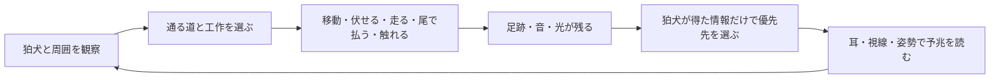

# 『こぎつねと冬の灯り』ゲーム設計書

版: 0.5／2026-10-07  
状態: **レビュー用草案。ゲームの体験とルールを定義する文書であり、実装開始の指示ではない。**

本書は[要件定義書](requirements.md)を、プレイヤーが実際に行うことへ落としたもの。物語上の出来事は[ストーリー設計](../research/fox-story-design.md)、狛犬へのJev適用の根拠は[狛犬の設計案](../research/fox-jev-design.md)を参照する。要件定義で決定済みの内容は「確定」、本書で具体化した遊び方は「提案」とする。画風・描画技術・数値調整・レベルの正確な地形は後続文書で決める。

## 1. ゲームの核

**一文でいう遊び:** 子狐が雪に残す痕跡、鳴らす鈴、奪った灯籠の光を使い、慎重な狛犬の注意を読みながら、家族のために灯りを持ち帰るステルスゲーム。

**プレイヤーの目標:** 巣から神社へ行き、灯籠を取って巣へ戻る。狛犬を倒すことは目標にも手段にも含めない。結末は、狛犬が弟妹の事情を自分の目で知り、火を分けて灯籠を戻す一つの展開にする。[要件 P-05、G-01](requirements.md)。

神社と森をつなぐ鳥居と倒木の二つの出入口は決定済み（D-16）。どちらも往路・復路に使える。子狐は倒木の下を伏せて通れ、山犬はその下を通れないが周囲を迂回できる。各経路の具体的な長さと危険度は試遊で調整する。

**設計の柱:**

1. **狐らしい身体で遊ぶ。** 小さな体で隠れ、尾で足跡を消し、口で灯籠を運ぶ。可愛さが操作と攻略につながる。
2. **狛犬の視点を推測する。** 狛犬に見えた足跡、聞こえた鈴、見えた光だけが判断材料となる。プレイヤーは痕跡を残すか消すか選ぶ。
3. **AIの判断が盤面を変える。** 狛犬が何を優先するかで安全な道が変わる。行動には視線・耳・姿勢の予兆があり、驚きと納得が両立する。
4. **同じ道が別の問題になる。** 往路では足跡を隠し、復路では灯籠の光を抱えたまま戻る。盗んだ達成感が新しい緊張へつながる。

### このゲームでプレイヤーに考えてほしいこと

> 「狛犬は、今どの手掛かりを知っている？」「次にどちらを確かめに行く？」「その間、自分はどこを通れる？」

最適解を一つ暗記するパズルにはしない。同じ場面でも、狐が残した証拠と狛犬が過去に実際に調べたことが違えば、通れる道が変わる。一方で、狛犬が何も知らない場所へ突然向かう、見えない狐を追い続けるなどの不公平は起こさない。

## 2. 完成版の進行

| 段階 | 狐がすること | 新しく学ぶこと | 狛犬・危険の役割 |
| --- | --- | --- | --- |
| 巣 | 寒がる弟妹と消えた火を見る。神社の灯りを目標に出発する | 目的、移動、操作UI | 狛犬は登場しない |
| 杉の森 | 雪を歩き、伏せる・走る・尾で払う・触れるを試す | 行動には痕跡と音が伴う | 遠景で狛犬の存在を予告する |
| 鳥居と鈴 | 狛犬の様子を見て、足跡を残す／消す、鈴を使う、隠れ道を選ぶ | 狛犬は手掛かりを比較して優先先を決める | **開始後5〜10分以内の最初のJev見せ場** |
| 境内 | 狛犬の持ち場と調査先を読み、灯籠に近づいて取る | 守られている物を盗む緊張 | 狛犬は状況により調査・見張り・追跡を選ぶ |
| 帰路 | 灯籠の光を隠しきれないまま森を戻る | 往路と同じ遮蔽物の価値が変わる | 狛犬は観測した光・足跡と過去の記憶を使う |
| 巣の結末 | 弟妹に灯籠を届ける | 狐の目的と狛犬の役目が両立する | 狛犬は巣を実際に見て事情を知る |

**総プレイ時間は未決定。** 表は体験の順番であり、制作日程や各場面の所要時間を示さない。初見で最初のJev見せ場へ10分以内に到達できるよう、巣と森の導入には長い説明や寄り道を置かない。放置時間や意図的な足止めは評価対象から分ける。

## 3. 基本ループ

**短い一回の駆け引き:** 狛犬の位置を見る → 鈴を鳴らすか、足跡を隠すか決める → 狛犬の予兆を見る → 開いた道を通る。もし予想が外れても、遮蔽物へ伏せる・道を変える・灯籠を置くなど、再判断の余地を残す。

**長いループ:** 巣を出る → 鳥居で狛犬の性格を知る → 境内で灯籠を取る → 持ち帰り方を考える → 巣へ届ける。往路の工作の経験が、復路で狛犬の記憶として効く場合がある。

## 4. 子狐の行動

画面右下のボタンはプレイ中ずっと同じ位置に表示する。以下の四つは[要件 P-02](requirements.md)に基づく現行案。最終的なボタンの絵やキー配置は`ui-and-controls.md`で決める。

| 行動 | プレイヤーが得るもの | 代償・制限 | 狛犬が気づけること |
| --- | --- | --- | --- |
| **伏せる** | 体を低くし、遮蔽物や低い抜け道を使える。足音が小さくなる | 移動が遅くなる。開けた場所では完全には隠れない | 直接見えていなければ位置を知らない。雪の跡は残る |
| **走る** | 開けた場所を早く横切れる | 足音が大きくなり、痕跡も目立つ。灯籠をくわえると速度に制限がかかる案 | 聞こえた音、視界に入った狐や足跡 |
| **尾で払う** | 近くの新しい足跡を雪でならす | その場に短く留まる。遠い跡や狛犬が既に見た記憶は消せない | 払う動作そのものが見えた時は狐を発見できる |
| **触れる** | 近くの鈴を鳴らす、灯籠をくわえる／置くなど、対象に応じて働きかける | 対象に近づく必要がある。灯籠をくわえている間は口を使う別の操作を制限する | 鈴の音、灯籠がなくなった台座や運ばれる光を、感知できた時だけ知る |

歩行も雪に足跡を残す。**伏せれば痕跡がゼロになるわけではない**。足跡を完全に消せる範囲・走った時の差・風で薄れる速さは、盤面を作ってから調整する。尾で払う行為が万能にならないよう、見張られている場所では時間を使うリスクを残す。

「触れる」は一つのボタンだが、対象名と結果を押す前に示す。鈴と灯籠が近い場所でも意図しない方を操作しない。灯籠をくわえた時は尾で払う操作を残し、鈴など口を使う工作は制限する案とする。制限の最終範囲はゲームテストで判断する。

## 5. 痕跡・音・光のルール

| 情報 | 世界に起こること | 狛犬が知る条件 | プレイヤーへの伝え方 |
| --- | --- | --- | --- |
| **足跡** | 狐が雪を踏んだ位置と進んだ向きが残り、時間と風で薄れる | 狛犬が視界に入れる、または近づいて調べる | 雪の凹みと新旧の見た目、狛犬が前足で確かめる動き |
| **鈴・枝の音** | 鳴った位置と音の種類が短い手掛かりになる | 聞こえる範囲に狛犬がいる | 音と同時に揺れや雪落ちなど視覚の反応を見せる |
| **狐の姿** | 視界にいる間は直接追える。遮蔽に入ると最後に見た場所だけを覚える | 狛犬が実際に狐を見た時 | 視線、身構え、足音の変化 |
| **灯籠の状態** | 盗むと台座が暗くなり、運ぶ狐の近くが明るくなる | 狛犬が空の台座か運ばれる光を見た時 | 境内全体の明暗、狛犬の振り返り |

狛犬に渡すのは**観測した事実**と、以前の観測から持っている**記憶**だけ。たとえば鈴の音を聞いただけでは、「狐が鳴らした」と確定しない。狐が森にいるという正解も、見聞きしていなければ知らない。狛犬が足跡を見た後に狐が消しても、既に得た記憶は残る。[要件 A-01、N-04](requirements.md)。

## 6. 狛犬とJevのゲーム上の役割

狛犬は**任務に忠実で慎重、幼い動物には情がある**守護者という性格案を持つ。D-17により、採用した性格から「灯籠を守る」「未確認の音を慎重に扱う」などの行動傾向を固定し、実際に得た手掛かりと記憶に合う合法な意図をJevが選ぶ。確率による抽選はしない。性格の具体的な強さと手掛かりが競合する場面の優先順位は固定盤面で検証する。狛犬の正確な状態項目・候補・通信条件は`komainu-jev.md`で定める。

**二つの姿（D-14）:** 守り手は神社の低い定位置では石の狛犬。そこで鈴・足跡・灯籠の様子を見聞きして判断し、持ち場を離れて調べる・追うと決めた時に、生きた山犬の姿になって歩き出す。同じ一体のまま観測と記憶を引き継ぐ。空振りして持ち場へ戻り役目が落ち着いた時、または結末で灯籠を戻した時に、定位置で石へ戻る。追跡中の突然の石化や一定時間だけの変身は使わない。変化の開始はJevが選ぶ行動意図をゲーム側が演出するもので、鈴が鳴っただけで自動発動する効果ではない。石像から山犬になる直前には耳・目線、落ちる雪、踏み出す前足の順で予兆を示す。

| 狛犬が得た状況 | 行動意図の候補例 | プレイヤーに見える予兆 |
| --- | --- | --- |
| 灯籠は無事、鈴だけ聞いた | 門を守る／鈴の方を短く確認する | 石のまま耳を向け、灯籠を見直す。持ち場を離れる選択なら山犬へ変わって歩き出す |
| 鈴と新しい足跡を別方向に見つけた | 門を守る／鈴を調べる／足跡を追う | 足跡と鈴を順に見て、選んだ方へ体を向ける |
| 以前鈴を調べて空振りした | 門を守る／別の手掛かりを優先する／再確認する | 鈴に反応しても、すぐには持ち場を離れない場合がある |
| 空の台座を実際に見た | 最後の目撃点を調べる／出口を警戒する／光を追う | 台座を見て止まり、出口や光の方向を見る |
| 巣で弟妹を実際に見た | 物語上の確定した救助場面へ進む | 足音を止め、体を低くし、前足をためらわせる |

最後の救助と灯籠を戻す結末はJevの一回の選択結果に委ねない。Jevはそこへ至るまでの追跡・警戒・ためらいの違いに使う。視界、移動、経路、衝突、捕獲、物語の必須条件はゲームのルールとして扱う。D-17に従い、狛犬が得た情報や調査結果が意味を持って変わった時に短い判断を求める。連続した観測をまとめる条件は試遊と通信量の計測で調整する。

### Jevの選択でゲームが詰まらない条件

- 狛犬が**鈴を調べる**なら、門の前を通る機会が生まれる。ただし狐の足跡を放置すると、戻った狛犬が見つける可能性がある。
- 狛犬が**足跡を追う**なら、別の抜け道を使う機会が生まれる。追う先に狐がいない場合、狛犬はその事実を記憶できる。
- 狛犬が**門を守る**なら、低い倒木の道や遮蔽物を使って迂回できる。これは簡単な正解ではなく、時間や痕跡の代償を伴う。
- 狛犬が**出口を警戒する**なら、灯籠を一時的に置く、遮蔽物で光を隠す、別の道を選ぶ余地を残す。

どの合法な判断が出ても、少なくとも一つの対処手段か、理解できる失敗からの再挑戦があるように場面を設計する。「Jevがたまたまその候補を選ばないと進めない」構造にしない。

## 7. 最初のJev見せ場

**場所:** 鳥居の手前から境内の灯籠が見える地点。狐は狛犬の様子を安全な位置から観察できる。鈴、雪の道、低い抜け道を同じ画面に置く案。

**成立までの流れ:**

1. 巣で「灯りを持ち帰る」目的を見せ、森で足跡と尾で払う操作を短く経験させる。
2. 鳥居に着くと、風で鈴が一度鳴る。プレイヤーはさらに鈴を鳴らす、足跡を残す／消す、伏せて回るなどを選べる。
3. 狛犬は聞こえた音や実際に見えた足跡と、灯籠を守る役目を踏まえて、合法な行動意図を選ぶ。**門を守る選択でも、耳と視線で「考えて残った」ことが分かる**ようにする。
4. 選択に応じて通りやすい道が変わる。プレイヤーは予兆を見て進路を選び、初めて狛犬との駆け引きを経験する。

ここは決まった映像を見せるだけの場面にしない。狐が作った証拠により、狛犬の行動候補と結果が変わる。風の鈴は、プレイヤーが何もしなかった場合にも狛犬の最初の判断を見せるための**共通のきっかけ**であり、狐の工作に対する反応を置き換えるものではない。

**時間の要件:** 初見で普通に前へ進むプレイを観察し、開始から10分以内に上記の判断と結果が見られるか確かめる。到達が遅い場合は、演出の長さ・道の分岐・操作説明を見直す。ゲーム内の強制カウントダウンは設けない。[要件 P-07](requirements.md)。

## 8. 盗難と帰路の変化

**盗む前:** 狛犬は灯籠を守る役目があるため、音だけで無条件に遠くへ行かない。狐は足跡を残して誘うか、消して潜むかを選ぶ。

**盗む瞬間:** 狐が灯籠をくわえると、台座と周辺の明るさが変わる。プレイヤーは達成と危険の増加を同時に感じる。狛犬はその場にいなければ**盗難を自動で知らない**。台座・光・狐の姿などを観測した時に判断が変わる。

**帰り道:** 灯籠の光は狐を見つけやすくする一方、暗い森の道しるべにもなる。灯籠を置けば身軽になれるが、そこに置いた光自体が手掛かりになる。往路で使った隠れ場所も、光の漏れ方や狛犬が記憶した囮によって価値が変わる。

**巣へ到達:** 狛犬が到着した経緯や警戒の強さは異なってよい。ただし、狛犬が弟妹を見る前にその事情を知ったことにはしない。巣で事実を目撃した後に火を分ける結末へつなぐ。

## 9. 発見・捕獲・再挑戦

狛犬が狐を見た時点で即失敗にはしない。**気づく → 向きを変える → 追う → 近づいて捕まえる**という段階を見せ、狐が隠れる・道を変える余地を作る。遮蔽物へ入ると狛犬は最後に見た地点を調べられるが、見えない狐の現在地を自動では追わない。

捕まった場合は灯籠を神社に戻し、直前の安全な地点または場面の開始から再挑戦する案。失敗原因は「見つかった足跡」「鳴らした鈴」「見えた光」「直接見られた」などから説明できるようにする。狐や弟妹が死ぬ失敗演出は置かない。[ストーリー設計](../research/fox-story-design.md)。

チェックポイントの具体的な位置は[物語・レベル設計](story-and-levels.md)のCP-B／Cを基準に試遊で調整する。再挑戦時の狛犬の観測・記憶は、灯籠・足跡・位置・姿とともにCP保存時点へ戻す（D-18）。**再挑戦時に物語・灯籠・狛犬の状態が矛盾しないこと**を優先する。アプリ終了後のセーブ範囲はD-12として別に決める。

## 10. 分かりやすさと難易度

- **初見の理解:** 冒頭は弟妹、冷たい小枝、遠い灯籠を順に見せる。文章で世界のルールを説明し続けない。最初のJev見せ場までに必要な操作だけを体験させる。
- **手掛かりの読みやすさ:** 足跡は新旧で見え方を変える。鈴には音と揺れを与える。狛犬は判断前に耳・目・姿勢を動かす。色だけに頼らない。
- **選択の重さ:** 走ると速いが痕跡と音が増え、尾で払うと安全になるが足を止める。どの行動にも役割と代償がある。
- **理不尽さの抑制:** 狛犬の視界と音の届き方を、画面や動きから推測できるようにする。判断の変化には、実際に得た手掛かりや記憶がある。
- **難易度の調整:** 数値を隠れて操作する前に、通れる道、遮蔽物、足跡の見え方、予兆の長さを調整する。正確な数値は試遊後に決める。

## 11. UIとプレイ後の振り返り

右下の行動ボタンは操作可能かどうかにかかわらず定位置に残し、近くに対象がある時だけ「触れる」の説明を変える。操作できない理由は短く示す。操作中の画面にはJevの確率や通信情報を直接出さず、**狛犬の演技**で状態を伝える。[画面案](../research/fox-visual-implementation.md)。

プレイ後の短い「狛犬の記録」は追加候補。どの足跡・鈴・光を観測し、何を選んだかを時系列で示す。ただし、プレイ中の狐には狛犬の内部知識をそのまま見せない。記録の有無と表現は`ui-and-controls.md`で決める。

## 12. Jev接続と公開版に関係する体験

Windows向けの完成版はプレイ中のJev接続を必要とする。短い応答遅延や切断では狛犬が前の行動を短時間続けるか、定義済みの保守的な行動に切り替え、狐の操作・画面を止めない。復旧しても、その間に状況が変わった古い判断は採用しない。長時間切断の案内と再開方法は未決定。[要件 N-03](requirements.md)。

GitHubにはソースとWindows実行版を公開する。プレイヤーが使う実行版にJevの秘密鍵を含めないことが要件。どこで鍵を保管し、誰の利用量として処理するかは公開・運用設計で決める。**狛犬の理想的な判断を先に設計し、使用量と費用を見積もった後に必要なら予算を考える。**

## 13. 本書で保留すること

| 保留項目 | 次に決める文書・検証 | 現時点の扱い |
| --- | --- | --- |
| 各場面の正確な地形・障害物配置 | `story-and-levels.md` | 通行ルートと見せ場だけ本書で定義する |
| 子狐と狛犬の最終的な造形、画面の描画方式 | `art-and-audio.md`、`basic-design.md` | V-01では「立体のある絵本映画」を画風として採用。造形の詳細と描画方式はV-02以降に検証する |
| ボタンの絵、キー配置、警戒表示 | `ui-and-controls.md` | 右下の常設表示と四行動を現行案とする |
| 狛犬の観測項目、記憶の長さ、Jevへの入力、連続観測のまとめ方 | `komainu-jev.md` | 公平さ、性格、合法行動、予兆をゲーム要件とする |
| 足跡の寿命、視界、音の距離、追跡速度 | `komainu-jev.md`と試遊 | この段階で数値を固定しない |
| 総プレイ時間、終了後に再開できるセーブ | `story-and-levels.md`、`basic-design.md` | 最初のJev見せ場を10分以内に置くことだけ確定 |
| 長時間切断、API使用量と費用、GitHubのライセンス | `release-and-operations.md`、検証 | 理想的な体験を先に定義する。公開物に秘密鍵を含めない |

制作人数・完成時期・スケジュールはユーザーが管理し、本書では扱わない。実装、画像生成、外部サービスへの接続は本書の作成によって開始しない。

## 14. 本書のレビュー観点

1. 子狐の四行動に、使いどころと代償の両方があるか。
2. 最初のJev見せ場が、プレイヤーの工作によって変わる**プレイ可能な場面**になっているか。
3. 狛犬がどの合法行動を選んでも、狐が状況を読んで対応できるか。
4. 盗難で帰路の遊びが変わり、巣の結末まで因果がつながるか。
5. 設計案と未決定項目が混ざって、実装方式や数値を先に固定していないか。

本書のレビュー後に、レベルの正確な導線と見せ場を`story-and-levels.md`へ落とす。
