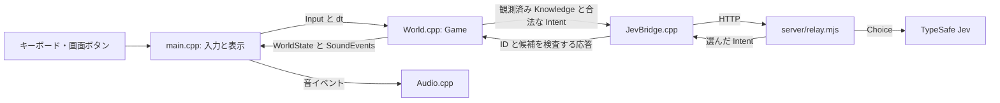
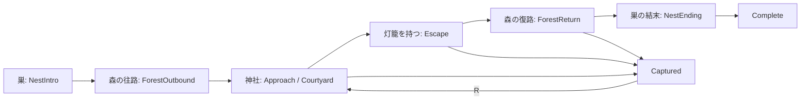

# 1. 全体の地図

設計の出発点は [基本設計](../design/basic-design.md) と [狛犬・Jev 仕様](../design/komainu-jev.md) です。実装では次の四層に分けました。

通信が設定されていないときは `World.cpp` の `LocalPersonalityPolicy` が同じ `DecisionRequest` を読みます。ゲームの進行は通信なしでも止まりません。

## 各ファイルの役割

| ファイル | 主な仕事 | 先に読む箇所 |
| --- | --- | --- |
| [World.hpp](../game/include/World.hpp) | `Stage`、`WorldState`、`Knowledge`、`Input`、判断要求を定義 | 列挙型、各 struct、`Game` |
| [World.cpp](../game/src/World.cpp) | 場面遷移、移動、視界、痕跡、捕獲、判断の検査 | `Game::Update`、`UpdatePerception` |
| [main.cpp](../game/src/main.cpp) | raylib のウィンドウ、入力、素材、描画、HUD | `main`、`ToCanvas` |
| [JevBridge.cpp](../game/src/JevBridge.cpp) | 中継への非同期 HTTP、応答の取り込み | `Request`、`Poll` |
| [relay.mjs](../server/relay.mjs) | 入力を絞り、Jev の Choice を呼ぶ | `normalize`、`decide` |
| [Audio.cpp](../game/src/Audio.cpp) | 音波形を作り、イベント回数の変化で鳴らす | `GameAudio::Poll` |

## 世界の正解と狛犬の知識を分ける

`WorldState` は子狐の現在位置を `fox.position` に持ちます。同じ構造の中でも `knowledge.lastSeen` は狛犬が**最後に見た位置**です。子狐が見えなくなって移動しても、後者は自動では追従しません。

この分離により、狛犬は隠れた子狐へ正確に向かえません。`server/relay.mjs` は `knowledge` から観測項目だけを作り直して Jev に渡します。子狐の真の位置、巣の事情、灯籠を盗んだ理由は渡しません。

## 場面の流れ

`ShrinePractice` は神社だけを確認する開発用の開始モードで、出口では `SliceComplete` になります。通常起動は `FullStory` です。神社と森は鳥居側と倒木側の二経路を使います。

## 手を動かす

1. `World.hpp` で `Stage` と `WorldState` を見つける。
2. `World.cpp` の `Game::Update` で `NestIntro` から `ForestOutbound` への遷移を探す。
3. `main.cpp` の `Objective` で、同じ `Stage` が画面の目的文にどう変換されるか確認する。

確認できたら「`Stage` を変更するのは誰か」「`Stage` を読むだけなのは誰か」を一文で説明してみてください。
