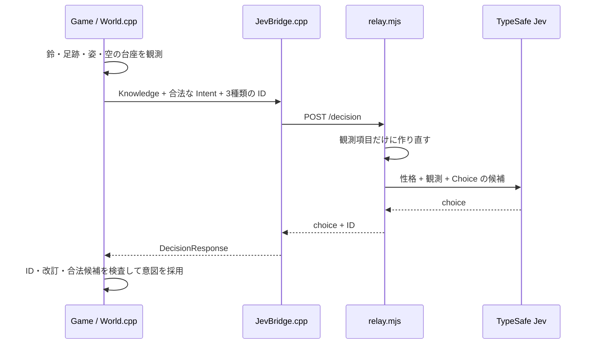

# 3. 狛犬は何を知り、どう選ぶか

採用した [D-17](../design/decision-log.md) は「性格から特徴と行動を決め、確率で抽選しない」です。狛犬の性格は、灯籠を守る責任感、具体的な手掛かりを調べる好奇心、子狐を傷つけない慈悲、空振り後の慎重さとして Jev に渡します。

## 一回の判断の流れ



`Game::UpdatePerception` が視界と足跡を判定し、`RecordObservation` が `Knowledge` を更新します。同じ事実を毎フレーム再観測しても、意味のある変化がなければ `revision` は増えず、新しい判断要求は作りません。

## 知らないことを送らない

たとえば鈴だけ聞いた時点では、狛犬は子狐を見ていません。判断要求は概念的に次の状態です。

```json
{
  "knowledge": {
    "bellHeard": true,
    "foxVisible": false,
    "theftKnown": false,
    "hasLastSeen": false,
    "bellPosition": {"x": 350, "y": 500}
  },
  "legalIntents": ["guard_lantern", "wait_and_watch", "inspect_bell"]
}
```

実際の通信には `attemptId`、`decisionId`、`revision` と、その他の知識フラグも入ります。この段階で `follow_visible_clue` や `watch_exit` は候補にありません。狛犬が知らない子狐の真の座標は送られません。

## 誰が何を決めるか

| 決めること | 担当 |
| --- | --- |
| 鈴が聞こえる、狐が見える、足跡が見える | `World.cpp` の判定 |
| 現時点で許される意図 | `Game::LegalIntents` |
| 観測と性格に合う意図を一つ選ぶ | Jev の `Choice`。オフライン時は `LocalPersonalityPolicy` |
| 意図の目標位置、移動速度、視界、警告、捕獲 | `World.cpp` |
| 古い返信・候補外の返信の拒否 | `Game::ApplyDecision` |

Jev の返答に確率が含まれても、ゲームは `choice` だけを使います。性格によって行動の理由を一貫させ、乱数で意図を選ぶ処理はありません。`LocalPersonalityPolicy` は通信を使わず練習するときの**決定的な代役**であり、Jev と同じ判断を必ず返す保証はありません。

意図が決まった後の移動は `UpdateGuardian` が担当します。倒木の低い通路を横切る直線が障害物に当たると、`GuardianWaypoint` が障害物の外側の角を経由する短い道を選びます。子狐が伏せて通れる場所でも山犬は通り抜けません。`GuardianWalksAroundLowPassage` テストは、この経路が低い通路の内部を通らないことを調べます。

## 非同期の理由

ネットワーク応答を描画ループの中で待つと画面が止まります。`JevBridge::Poll` は `std::future` を使い、送信中もゲームを描き続けます。新しい観測が届いたり、捕獲してやり直したりした後の古い返信は `Game::ApplyDecision` で拒否します。通信に失敗した場合は、同じ要求をローカル方針で解決します。

## 模擬中継を試す

別のターミナルで起動します。API キーは不要です。

```sh
JEV_MOCK=1 node server/relay.mjs
```

ゲームは次のように接続します。

```sh
JEV_RELAY_URL=http://127.0.0.1:8787/decision game/build/foxgame
```

`node` が見つからない環境ではインストール済み Node.js のフルパスを使います。本番 Jev は中継側だけに `TYPESAFE_API_KEY` を設定します。キーをソースやゲーム側に書き込まないでください。本番 API の動作確認はまだ行っていません。

## 読む・試す

1. [World.cpp](../game/src/World.cpp) の `LegalIntents` と `LocalPersonalityPolicy::Choose` を比較する。
2. [relay.mjs](../server/relay.mjs) の `normalize` で、受け取ったデータのどれを Jev へ渡すか確認する。
3. [test_contract.cpp](../tests/test_contract.cpp) の `DecisionFixtures` を読む。鈴だけ、足跡だけ、盗難を知った場合で候補がどう変わるかを説明する。
